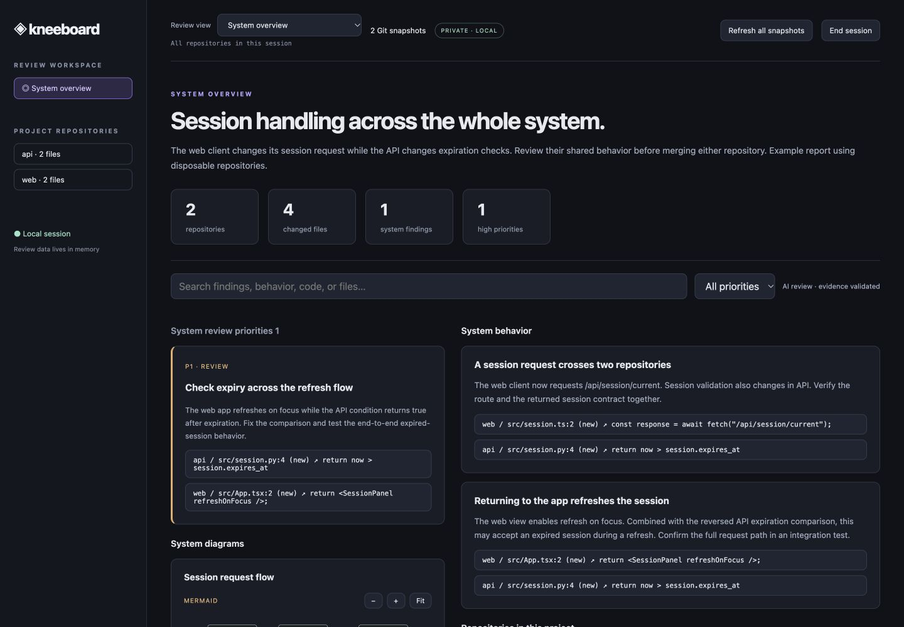
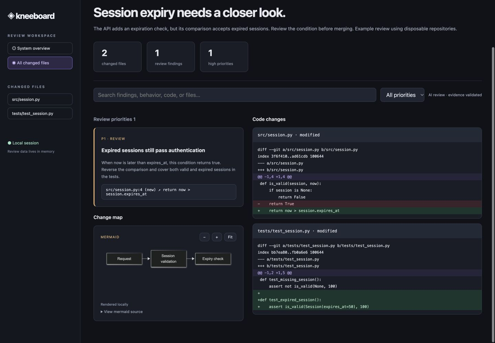
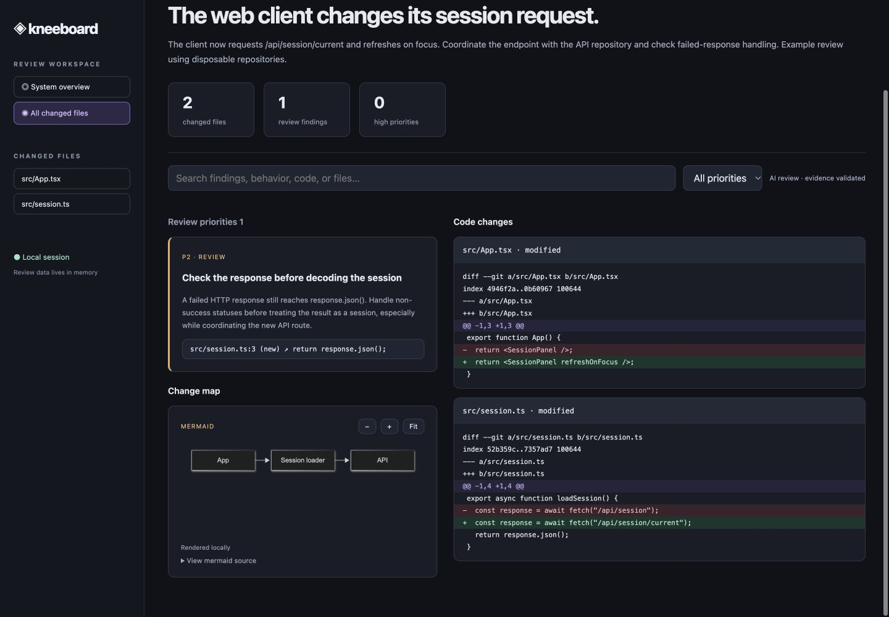
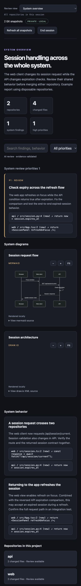
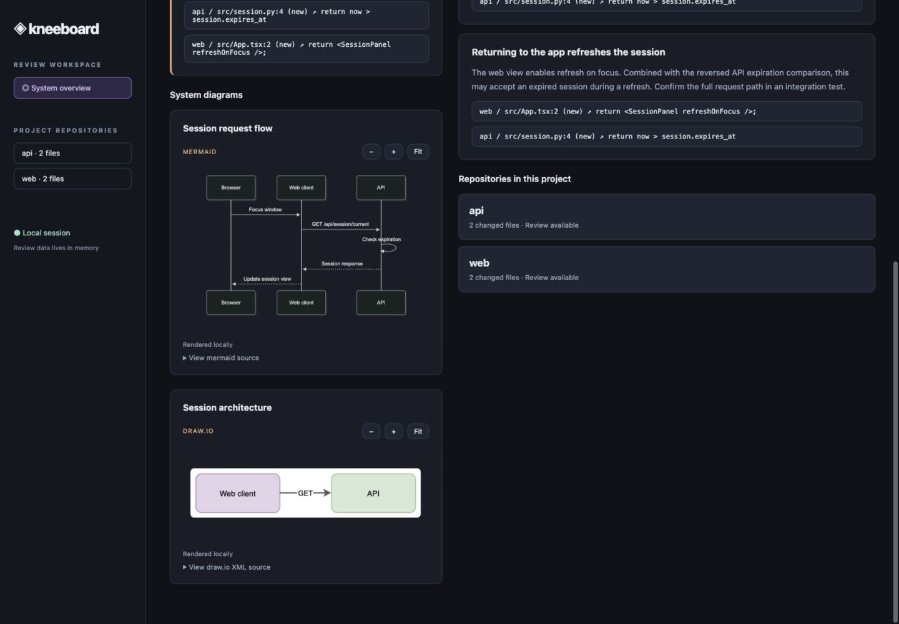

# Kneeboard

A temporary, local review workspace for people writing code with AI. Git supplies the actual changes; your AI supplies technical explanations and findings; a reusable HTML/JavaScript interface presents both consistently.



*Screenshot of the running System overview with two disposable example repositories. The Review view selector opens the system report or an individual repository.*

## Install

Requires **Python 3.10+**, **Git**, and a modern browser. No Python runtime dependencies, API key, cloud service, or Node.js build is required.

Clone the project and run the setup script:

```sh
git clone https://github.com/JPPrado1657/kneeboard.git
cd kneeboard
python3 scripts/setup.py
```

On Windows, use `py -3 scripts/setup.py` instead. The script creates `.venv`, installs Kneeboard, checks that the CLI runs, and installs both `kneeboard` and `kneeboard-update` skills into `${CODEX_HOME:-~/.codex}/skills`. It prints a launch command for your installation. Setup may download Python build dependencies, so an internet connection is required for a fresh installation.

Start a new AI session to load the skills. Other coding assistants can use the same files when they support `SKILL.md`. The CLI and repository must be accessible in the assistant's execution environment; a remote assistant cannot access a server running only on your laptop.

You can rerun setup after a failed installation. It reuses its virtual environment and reinstalls the app and bundled skills. Bundled skill files are replaced; keep personal customizations outside those folders. The script does not change your shell configuration or require administrator privileges.

Optional setup choices:

```sh
# Choose another assistant's skills directory.
python3 scripts/setup.py --skills-dir /path/to/skills

# Install the app without installing AI skills.
python3 scripts/setup.py --skip-skills

# Choose a different virtual environment location.
python3 scripts/setup.py --venv /path/to/kneeboard-env
```

### Run from any terminal

Activate the installed environment before using `kneeboard`:

```sh
source /absolute/path/to/kneeboard/.venv/bin/activate
kneeboard --help
```

On Windows, activate with `.venv\Scripts\Activate.ps1` in PowerShell. Activate again in each new terminal, or use the full Python launch command printed by setup to avoid activation. For developers, activate the environment and use `python -m pip install -e .` so source changes take effect immediately.

## Update with your AI assistant

The setup script installs the update skill automatically. To add it manually to an older installation:

```sh
mkdir -p ~/.codex/skills/kneeboard-update
cp -R skills/kneeboard-update/. ~/.codex/skills/kneeboard-update/
```

Existing users whose checkout predates this skill should first run `git pull --ff-only` in their Kneeboard project folder. Use your custom `CODEX_HOME` path instead of `~/.codex` if configured. Start a new AI session after copying the skill, then ask:

> Use the kneeboard-update skill to update my Kneeboard installation and both skills.

The assistant finds your checkout and installed Python environment. The update script fetches the official repository, fast-forwards a clean `main` checkout, reinstalls the application, and refreshes both bundled skills. It stops for local changes, a different origin, or local-only commits. It does not reset or stash your work. Bundled files in the two installed skill folders are replaced; keep any personal skill customizations elsewhere.

Updates follow the latest `main` commit, even if the package version number has not changed. Restart Kneeboard after updating and start a new AI session to load updated skills. Existing review sessions continue using the previously loaded code. If installation fails after Git updates, resolve the error and rerun; the updater retries installation even when the source is already current.

To run the updater yourself:

```sh
python3 skills/kneeboard-update/scripts/update.py \
  --repo "$PWD" \
  --python "$PWD/.venv/bin/python"
```

Run this from the Kneeboard checkout. On Windows use `.venv/Scripts/python.exe` for `--python`. Use `--skills-dir` to choose another assistant's skill directory. No background update service or persistent review history is added.

## Run a review

Run this in your terminal and keep it running:

```sh
kneeboard serve /absolute/path/to/your/repository
```

A browser opens and the terminal prints a private localhost session URL. The repository must have at least one commit. Default scope is **HEAD versus the current working tree**, including staged changes, unstaged changes, deleted files, and nonignored untracked files. Gitignored files are excluded. Files staged and then reverted in the working tree can have no net change versus HEAD.

Ask your AI:

> Use the Kneeboard skill to review my changes. Use the running session URL from my terminal. Explain the behavior changes, investigate likely defects, add evidence-backed findings and a change map, and state which checks you actually ran.

Give the assistant the printed URL if it cannot access your terminal. The URL is a session secret; keep it private. The AI reads the captured changes, inspects relevant code, and submits structured JSON. The report updates automatically within four seconds.

### Review a project with multiple repositories

List all repositories when starting the session:

```sh
kneeboard serve /absolute/path/to/api /absolute/path/to/web /absolute/path/to/shared-library
```

Or tell your AI which repositories belong to the project:

> Use Kneeboard to review this project. The repositories are /work/api and /work/web. Start one session containing both, prepare a system overview of their shared behavior, and add a separate review for each repository.

Use the **Review view** selector at the top of the report to choose **System overview** or an individual repository. A multi-repository session opens on the system view. Select a repository to inspect its local changes. In a repository view, the selected repository controls the file list, diffs, findings, counts, summary, and change map. Switching clears the file selection, search, and priority filter so a filter from one repository cannot hide another repository's changes. Reports remain available when you switch back, and incoming AI updates do not change your selection.

The path below the selector identifies the checkout. If repositories share the same directory name, the selector shows their full paths to distinguish them. The same Git root cannot be listed twice, including through a subdirectory or symlink.



*Selecting API shows its own evidence-backed findings and diffs.*



*The same live session after switching to web: its files, findings, change map, and summary replace the API review.*

**Refresh snapshot** refreshes the selected repository, clears its report, and invalidates the system overview. Other repository reports remain available. Edits in another repository do not invalidate submissions for the selected one. All repositories share the session's temporary lifecycle; ending the session releases every repository's review data. Add or remove repositories by ending the session and starting it again with the desired paths.

`--base` applies to every listed repository, so use a ref that exists in all of them. The default `HEAD` compares each repository against its own current commit. Each repository must have an initial commit; an invalid repository stops startup with an error instead of silently omitting it.

### System overview

Some changes only make sense across the whole project. **System overview** is a separate report for that context:

- **System behavior** explains end-to-end flows and contracts between repositories, with code references from the repositories involved.
- **System diagrams** can include multiple named architecture, request-flow, or state-transition views.
- **System review priorities** capture findings whose cause or impact spans repositories. Evidence links switch to the correct repository and highlight the cited code when it is in the diff.
- Repository cards open each repository's local review without losing the overview.

The AI submits this report independently of repository reviews. It can have a system summary and diagrams even when no repository-specific report is ready. Each behavior and finding needs code evidence; diagram relationships and behavioral reasoning remain AI explanations rather than verified static analysis.

The report records the snapshot ID for every repository. Refreshing any repository invalidates the overview so it can be regenerated against current snapshots. **Refresh all snapshots** in System overview recaptures every repository and clears all repository reports and the system report. Switching views alone keeps the reports intact. System data stays in memory and is released with the rest of the session.

<details>
<summary>Mobile layout</summary>



</details>

To review changes relative to another commit or branch:

```sh
kneeboard serve /absolute/path/to/repo --base main
```

This compares the selected base directly with the current working tree, rather than using a merge base. For a branch review from its common ancestor, calculate that commit first:

```sh
kneeboard serve /absolute/path/to/repo --base "$(git -C /absolute/path/to/repo merge-base main HEAD)"
```

For a terminal-only environment:

```sh
kneeboard serve /absolute/path/to/repo --no-open
```

Open its printed URL on the same computer. After editing code, click **Refresh snapshot**, then ask the AI to review the new snapshot. Refresh discards the previous AI report for the selected repository. Submissions are rejected if the repository changed since capture.

Click **End session**, close the report tab, or press **Ctrl+C** in the server terminal to finish. Start a new server for the next review.

## Features

| Feature | What it provides |
| --- | --- |
| Consistent report | Fixed HTML, CSS, and JavaScript; the AI supplies data rather than redesigning the output. |
| Multiple repositories | Start one session with all project repositories and switch the entire review using the Review view selector. |
| System overview | Describe shared behavior, render multiple named diagrams, and review findings with evidence across repositories. |
| Git-backed snapshot | Exact base commit, file changes, old/new content, textual diffs, and snapshot fingerprint. |
| Review priorities | P0–P3 findings sorted by urgency and filterable by priority. |
| Verified evidence | Each finding references a file, old/new side, line number, and exact quote checked against the snapshot. Click evidence to jump to its diff location when present. |
| Search and file navigation | Search finding content, paths, and diff text; narrow the report to one changed file. |
| Diagrams | Locally rendered Mermaid, draw.io XML, SVG, or simple graphs, with source previews and zoom controls. |
| Stale-review protection | Repository changes invalidate new report submissions until the snapshot is refreshed. |
| Private local session | Loopback-only HTTP, random session URL, no remote assets, no database, no local-storage review history. |

Evidence validation proves the quote exists at the specified snapshot location. It does **not** prove the AI's conclusion is correct. Change-map connections are AI explanations, not verified static analysis. Review quality depends on the assistant and its investigation. A report with zero findings does not establish correctness.

## How the AI creates diagrams

The AI supplies diagram source in its report JSON. Kneeboard handles the layout and rendering with the same local viewer each time. Both repository change maps and system diagrams support:

| Format | AI supplies | Local visualizer |
| --- | --- | --- |
| Mermaid (recommended) | Text such as `flowchart LR` or `sequenceDiagram` | Bundled [Mermaid](https://mermaid.js.org/config/usage.html) 12.3.0, MIT licensed |
| draw.io | Uncompressed `mxGraphModel` or `mxfile` XML, including node positions | Bundled [draw.io viewer](https://github.com/jgraph/drawio/wiki/Embedding) v32.6.10, Apache-2.0 source code |
| SVG | Self-contained SVG markup | Browser image renderer inside the diagram sandbox |
| Simple graph | A list of node labels and directed edges | Kneeboard's original lightweight map |

For example, the AI can supply:

```json
{
  "title": "Session request flow",
  "format": "mermaid",
  "source": "sequenceDiagram\n  Web->>API: Request session\n  API-->>Web: Session response"
}
```

This goes in `diagrams` for a system report, or in `diagram` for a repository report. Multiple system diagrams can use different formats in the same report. Mermaid handles layout automatically; draw.io XML includes positions and retains the source structure for use in draw.io. **View source**, zoom, and fit controls are available in each rendered panel. The draw.io integration is a viewer, not an embedded editor.



*Both formats rendered in the running local report from AI-style source data.*

SVG is a [W3C web standard](https://www.w3.org/TR/SVG2/), and Mermaid and draw.io also render vector graphics. The distinction is the authoring format: Mermaid describes a diagram in text, draw.io uses its diagram XML, and raw SVG describes the drawing itself. Kneeboard keeps the submitted source in memory; it does not require saving diagram files.

No CDN, hosted editor, API key, or Node.js installation is needed to view diagrams. Renderer bundles and their licenses are included in the Python package. Rendering happens in a sandbox separate from the report; its content security policy blocks network connections and external images. Mermaid runs in strict mode with source configuration overrides disabled. draw.io supports uncompressed XML and built-in shapes; external stencil packs, image assets, MathJax, and hosted integrations are unavailable. A diagram that fails to parse shows an error in its panel while the rest of the report stays usable.

Pinned bundle versions, checksums, upstream sources, and licenses are documented in [the vendor notes](kneeboard/web/vendor/README.md). Their installed code stays on disk like the rest of the application; submitted diagram source and rendered review data follow the temporary session lifecycle below.

## Temporary data lifecycle

The server holds snapshots and reports in process memory. It does not write them to the repository, temporary files, a database, or browser storage. Responses use `Cache-Control: no-store`. The UI sends a close signal when its page is left, and sends a heartbeat every four seconds while open. If the browser crashes or a close signal is lost, the server exits after **120 seconds** without a heartbeat. Configure that fallback with `--idle-timeout 300` (minimum 30 seconds).

**Use Refresh snapshot inside the interface. Reloading or navigating away from the page ends the session too.** A session is designed for one report tab. Opening multiple copies does not create independent sessions. Browser background throttling or computer suspension can cause expiration; restart the tool if needed.

On server shutdown, the application releases its review state and exits. This is not secure memory erasure and does not control operating-system swap, browser crash recovery, AI chat history, terminal scrollback, or files you explicitly save yourself. The installed program, source repository, and installed skill remain on disk.

## AI integration contract

The local server is the integration API; the skill documents the review workflow. No vendor-specific MCP server or browser extension is required for this version.

All routes are relative to the printed session URL:

| Method and route | Purpose |
| --- | --- |
| `GET state` | Read `{repositories: [{id, name, path, snapshot, report}], overview: {snapshotIds, report}}`. Each snapshot contains `id`, `repositoryId`, `base`, `repository`, and `files`. Single-repository sessions also include the original top-level `snapshot` and `report` fields. |
| `POST report` | Submit report JSON matching the target repository snapshot. Include `repositoryId` for multi-repository sessions. |
| `POST overview` | Submit the system report with the complete `snapshotIds` mapping, behaviors, findings, and named diagrams. Evidence entries must include `repositoryId`. |
| `POST refresh-all` | Recapture every repository and clear all reports, including the system overview. |
| `POST refresh` | Recapture one repository, clear its report, and invalidate the system overview. Send `{"repositoryId":"id from state"}` for multi-repository sessions. |
| `POST heartbeat` | Keep the session alive. |
| `POST close` | Stop the server and release all repositories' review data. |

The AI can submit through stdin without creating a report file:

```sh
kneeboard submit http://127.0.0.1:PORT/SESSION_TOKEN/ --repo REPOSITORY_ID_FROM_STATE <<'JSON'
{
  "snapshotId": "SNAPSHOT_ID_FOR_THIS_REPOSITORY",
  "title": "Explain the concrete change",
  "summary": "Behavior changes, checks actually run, and remaining uncertainties.",
  "findings": [],
  "diagram": {
    "format": "mermaid",
    "source": "flowchart LR\n  Caller --> ChangedComponent"
  }
}
JSON
```

Replace the URL, repository ID, and snapshot ID with the live values from `state.repositories`. Submit a separate report for each repository. The `--repo` option adds `repositoryId` to the JSON; you can supply that field directly instead. Omitting the repository target is supported only in single-repository sessions. A repository ID identifies its checkout, and a snapshot ID identifies that checkout's captured changes; they are not interchangeable. For finding and evidence fields, see [the skill](skills/kneeboard/SKILL.md). A repository report is limited to 2 MB and 200 findings; diagram source is limited to 100000 characters, or 30 nodes in the original simple graph format.

To submit the system report, use `kneeboard submit <session-url> --overview` with a JSON object containing `snapshotIds` (the complete mapping from `state.overview.snapshotIds`), `title`, `summary`, `behaviors`, `findings`, and `diagrams`. Each behavior contains `title`, `detail`, and `evidence`; each diagram contains a `title`, `format`, and `source` (or the original `nodes` and `edges` fields for a simple graph). System evidence adds a `repositoryId` to the standard file/side/line/quote fields. See [the skill's system overview schema](skills/kneeboard/SKILL.md#system-overview) for a full example. System reports support up to 100 behavior descriptions, 200 findings, and 10 diagrams, with a 100000-character limit for each source (or 30 nodes in the simple graph format), within the 2 MB submission limit. Submission is rejected if any repository changed since capture.

## Coverage and limitations

- Binary files, files or diffs above 1 MB, and symlink target contents are excluded from textual review and labeled in the UI.
- The collector does not execute repository code, hooks, external diff commands, or text conversion drivers. Tests only run when your assistant explicitly runs them.
- This version reviews a working tree against a commit. It does not provide commit browsing, inline editing, Git staging, automatic fixes, submodule-internal diffs, or a native desktop installer.
- Review data and a repository-wide context index are never persisted by this tool. The assistant can independently inspect repository context using its existing tools.
- The initial snapshot is read sequentially. Avoid editing while collecting; submission checks the collected fingerprint again. A repository changing continuously can require another refresh.

## Development and checks

```sh
python3 -m unittest discover -s tests -v
node --check kneeboard/web/app.js
node --check kneeboard/web/diagram.js
```

Tests create isolated temporary Git repositories and check staged/untracked/deleted files, binary and symlink exclusions, evidence rejection, stale submissions, HTTP access, refresh, shutdown, and isolation between repositories with identical names and file paths, system-overview evidence and invalidation, and multi-repository CLI startup. Setup and updater tests check installation safeguards and preservation of local work. The integration test requires permission to bind a local loopback port. Node.js is optional and used only for the JavaScript syntax check.
