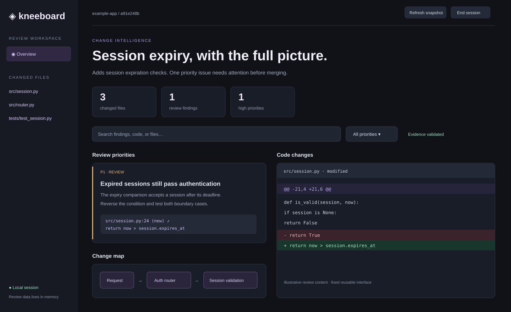

# Kneeboard

A temporary, local review workspace for people writing code with AI. Git supplies the actual changes; your AI supplies technical explanations and findings; a reusable HTML/JavaScript interface presents both consistently.



*Interface illustration using example review content. Findings shown are illustrative.*

## Install

Requires **Python 3.10+**, **Git**, and a modern browser. No Python runtime dependencies, API key, cloud service, or Node.js build is required.

Clone the project and run the setup script:

```sh
git clone https://github.com/JPPrado1657/kneeboard.git
cd kneeboard
python3 scripts/setup.py
```

On Windows, use `py -3 scripts/setup.py` instead. The script creates `.venv`, installs Kneeboard, checks that the CLI runs, and installs both `kneeboard` and `kneeboard-update` skills into `${CODEX_HOME:-~/.codex}/skills`. It prints a launch command for your installation. Setup may download Python build dependencies, so an internet connection is required for a fresh installation.

Start a new AI session to load the skills. Other coding assistants can use the same files when they support `SKILL.md`. The CLI and repository must be accessible in the assistant's execution environment; a remote assistant cannot access a server running only on your laptop.

You can rerun setup after a failed installation. It reuses its virtual environment and reinstalls the app and bundled skills. Bundled skill files are replaced; keep personal customizations outside those folders. The script does not change your shell configuration or require administrator privileges.

Optional setup choices:

```sh
# Choose another assistant's skills directory.
python3 scripts/setup.py --skills-dir /path/to/skills

# Install the app without installing AI skills.
python3 scripts/setup.py --skip-skills

# Choose a different virtual environment location.
python3 scripts/setup.py --venv /path/to/kneeboard-env
```

### Run from any terminal

Activate the installed environment before using `kneeboard`:

```sh
source /absolute/path/to/kneeboard/.venv/bin/activate
kneeboard --help
```

On Windows, activate with `.venv\Scripts\Activate.ps1` in PowerShell. Activate again in each new terminal, or use the full Python launch command printed by setup to avoid activation. For developers, activate the environment and use `python -m pip install -e .` so source changes take effect immediately.

## Update with your AI assistant

The setup script installs the update skill automatically. To add it manually to an older installation:

```sh
mkdir -p ~/.codex/skills/kneeboard-update
cp -R skills/kneeboard-update/. ~/.codex/skills/kneeboard-update/
```

Existing users whose checkout predates this skill should first run `git pull --ff-only` in their Kneeboard project folder. Use your custom `CODEX_HOME` path instead of `~/.codex` if configured. Start a new AI session after copying the skill, then ask:

> Use the kneeboard-update skill to update my Kneeboard installation and both skills.

The assistant finds your checkout and installed Python environment. The update script fetches the official repository, fast-forwards a clean `main` checkout, reinstalls the application, and refreshes both bundled skills. It stops for local changes, a different origin, or local-only commits. It does not reset or stash your work. Bundled files in the two installed skill folders are replaced; keep any personal skill customizations elsewhere.

Updates follow the latest `main` commit, even if the package version number has not changed. Restart Kneeboard after updating and start a new AI session to load updated skills. Existing review sessions continue using the previously loaded code. If installation fails after Git updates, resolve the error and rerun; the updater retries installation even when the source is already current.

To run the updater yourself:

```sh
python3 skills/kneeboard-update/scripts/update.py \
  --repo "$PWD" \
  --python "$PWD/.venv/bin/python"
```

Run this from the Kneeboard checkout. On Windows use `.venv/Scripts/python.exe` for `--python`. Use `--skills-dir` to choose another assistant's skill directory. No background update service or persistent review history is added.

## Run a review

Run this in your terminal and keep it running:

```sh
kneeboard serve /absolute/path/to/your/repository
```

A browser opens and the terminal prints a private localhost session URL. The repository must have at least one commit. Default scope is **HEAD versus the current working tree**, including staged changes, unstaged changes, deleted files, and nonignored untracked files. Gitignored files are excluded. Files staged and then reverted in the working tree can have no net change versus HEAD.

Ask your AI:

> Use the Kneeboard skill to review my changes. Use the running session URL from my terminal. Explain the behavior changes, investigate likely defects, add evidence-backed findings and a change map, and state which checks you actually ran.

Give the assistant the printed URL if it cannot access your terminal. The URL is a session secret; keep it private. The AI reads the captured changes, inspects relevant code, and submits structured JSON. The report updates automatically within four seconds.

To review changes relative to another commit or branch:

```sh
kneeboard serve /absolute/path/to/repo --base main
```

This compares the selected base directly with the current working tree, rather than using a merge base. For a branch review from its common ancestor, calculate that commit first:

```sh
kneeboard serve /absolute/path/to/repo --base "$(git -C /absolute/path/to/repo merge-base main HEAD)"
```

For a terminal-only environment:

```sh
kneeboard serve /absolute/path/to/repo --no-open
```

Open its printed URL on the same computer. After editing code, click **Refresh snapshot**, then ask the AI to review the new snapshot. Refresh discards the previous AI report. Submissions are rejected if the repository changed since capture.

Click **End session**, close the report tab, or press **Ctrl+C** in the server terminal to finish. Start a new server for the next review.

## Features

| Feature | What it provides |
| --- | --- |
| Consistent report | Fixed HTML, CSS, and JavaScript; the AI supplies data rather than redesigning the output. |
| Git-backed snapshot | Exact base commit, file changes, old/new content, textual diffs, and snapshot fingerprint. |
| Review priorities | P0–P3 findings sorted by urgency and filterable by priority. |
| Verified evidence | Each finding references a file, old/new side, line number, and exact quote checked against the snapshot. Click evidence to jump to its diff location when present. |
| Search and file navigation | Search finding content, paths, and diff text; narrow the report to one changed file. |
| Change map | AI-supplied component labels and directed connections, rendered without remote scripts. |
| Stale-review protection | Repository changes invalidate new report submissions until the snapshot is refreshed. |
| Private local session | Loopback-only HTTP, random session URL, no remote assets, no database, no local-storage review history. |

Evidence validation proves the quote exists at the specified snapshot location. It does **not** prove the AI's conclusion is correct. Change-map connections are AI explanations, not verified static analysis. Review quality depends on the assistant and its investigation. A report with zero findings does not establish correctness.

## Temporary data lifecycle

The server holds snapshots and reports in process memory. It does not write them to the repository, temporary files, a database, or browser storage. Responses use `Cache-Control: no-store`. The UI sends a close signal when its page is left, and sends a heartbeat every four seconds while open. If the browser crashes or a close signal is lost, the server exits after **120 seconds** without a heartbeat. Configure that fallback with `--idle-timeout 300` (minimum 30 seconds).

**Use Refresh snapshot inside the interface. Reloading or navigating away from the page ends the session too.** A session is designed for one report tab. Opening multiple copies does not create independent sessions. Browser background throttling or computer suspension can cause expiration; restart the tool if needed.

On server shutdown, the application releases its review state and exits. This is not secure memory erasure and does not control operating-system swap, browser crash recovery, AI chat history, terminal scrollback, or files you explicitly save yourself. The installed program, source repository, and installed skill remain on disk.

## AI integration contract

The local server is the integration API; the skill documents the review workflow. No vendor-specific MCP server or browser extension is required for this version.

All routes are relative to the printed session URL:

| Method and route | Purpose |
| --- | --- |
| `GET state` | Read `{snapshot, report}`. Snapshot contains `id`, `base`, `repository`, and `files`. |
| `POST report` | Submit report JSON matching the current snapshot. |
| `POST refresh` | Recapture Git changes and clear the report. |
| `POST heartbeat` | Keep the session alive. |
| `POST close` | Stop the server. |

The AI can submit through stdin without creating a report file:

```sh
kneeboard submit http://127.0.0.1:PORT/SESSION_TOKEN/ <<'JSON'
{
  "snapshotId": "ID_FROM_STATE",
  "title": "Explain the concrete change",
  "summary": "Behavior changes, checks actually run, and remaining uncertainties.",
  "findings": [],
  "diagram": {
    "nodes": ["Caller", "Changed component"],
    "edges": [["Caller", "Changed component"]]
  }
}
JSON
```

Replace the URL and snapshot ID with the live values. For finding and evidence fields, see [the skill](skills/kneeboard/SKILL.md). The report is limited to 2 MB, 200 findings, and 30 diagram nodes.

## Coverage and limitations

- Binary files, files or diffs above 1 MB, and symlink target contents are excluded from textual review and labeled in the UI.
- The collector does not execute repository code, hooks, external diff commands, or text conversion drivers. Tests only run when your assistant explicitly runs them.
- This version reviews a working tree against a commit. It does not provide commit browsing, inline editing, Git staging, automatic fixes, submodule-internal diffs, or a native desktop installer.
- Review data and a repository-wide context index are never persisted by this tool. The assistant can independently inspect repository context using its existing tools.
- The initial snapshot is read sequentially. Avoid editing while collecting; submission checks the collected fingerprint again. A repository changing continuously can require another refresh.

## Development and checks

```sh
python3 -m unittest discover -s tests -v
node --check kneeboard/web/app.js
```

Tests create isolated temporary Git repositories and check staged/untracked/deleted files, binary and symlink exclusions, evidence rejection, stale submissions, HTTP access, refresh, and shutdown. The integration test requires permission to bind a local loopback port. Node.js is optional and used only for the JavaScript syntax check.
